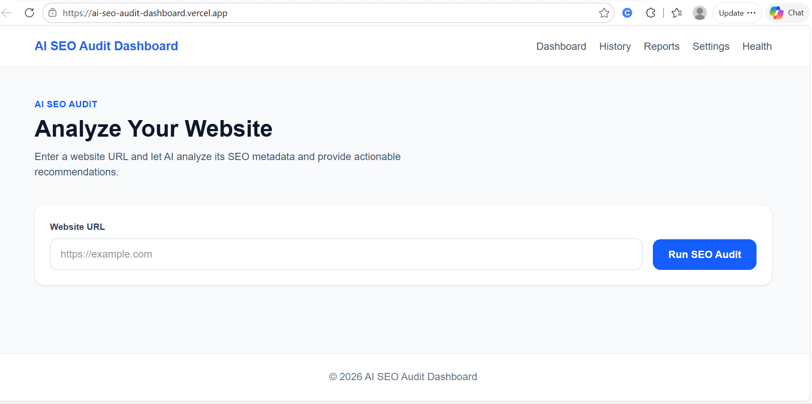
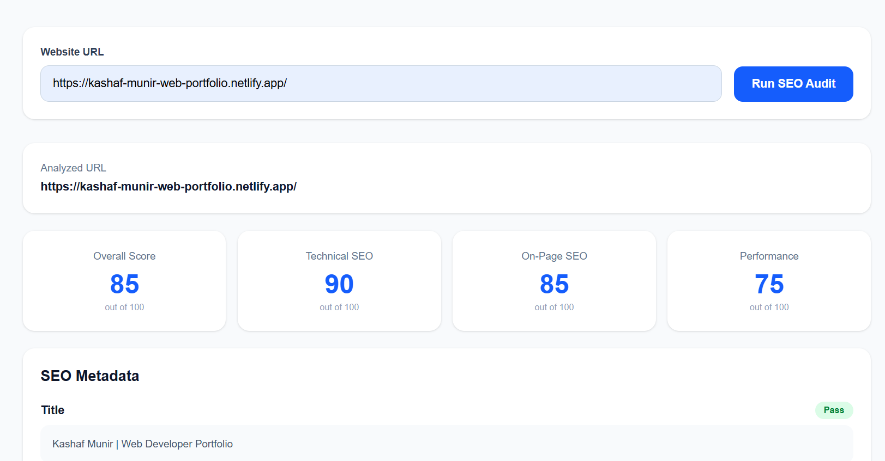

# AI SEO Audit Dashboard

An AI-powered SEO auditing dashboard that analyzes a website's basic SEO metadata and generates AI-assisted recommendations to help identify common on-page SEO issues.

**Live Demo:** [https://ai-seo-audit-dashboard.vercel.app/](https://ai-seo-audit-dashboard.vercel.app/)

**GitHub Repository:** [https://github.com/kashafbuilds/ai-seo-audit-dashboard](https://github.com/kashafbuilds/ai-seo-audit-dashboard)

---

## Project Overview

AI SEO Audit Dashboard allows users to enter a website URL and receive an automated analysis of its basic SEO metadata.

The application extracts important page elements, calculates SEO scores, and uses Google Gemini through the Vercel AI SDK to generate a summary and actionable recommendations.

The project demonstrates full-stack development, AI integration, API validation, rate limiting, automated testing, and production deployment.

## Features

- Analyze a website using its URL.
- Extract the page title, meta description, and H1 heading.
- Display an overall SEO score.
- Display technical SEO, on-page SEO, and performance scores.
- Generate AI-powered summaries and recommendations.
- Validate user input and handle API errors.
- Apply request limits to help reduce API abuse.
- Store rate-limit information using Upstash Redis.
- Provide a health endpoint.
- Access dashboard pages for audit history, reports, and settings.
- Deploy the application to Vercel.

**Note:** Scores are estimates produced by the application's current analysis logic. The dashboard is not a replacement for a complete technical SEO crawler or a real-world performance testing service.

## Tech Stack

- **Frontend:** Next.js, React, TypeScript, Tailwind CSS
- **AI Integration:** Vercel AI SDK, Google Gemini
- **Rate Limiting:** Upstash Redis, Upstash Rate Limit
- **Testing:** Vitest, React Testing Library
- **Deployment:** Vercel
- **Version Control:** Git and GitHub

## How It Works

1. The user enters a website URL.
2. The API validates the request and applies input limits.
3. The server fetches the target page's HTML.
4. The application extracts available SEO metadata, including the title, meta description, and H1 heading.
5. Google Gemini generates a summary and recommendations using the extracted information.
6. The dashboard displays the available SEO scores, summary, and recommendations.

## Architecture Overview

The project follows a Next.js application structure.

- **Frontend (`src/app`):** Provides the dashboard interface and displays audit results.
- **Audit API (`src/app/api/audit/route.ts`):** Validates requests, fetches website HTML, extracts metadata, and requests AI-generated feedback.
- **Health endpoint (`src/app/health`):** Provides a health check, depending on the current implementation.
- **Dashboard pages:** Include the main dashboard and history, reports, and settings pages.
- **Google Gemini:** Generates summaries and SEO recommendations.
- **Upstash Redis:** Supports shared rate-limit tracking between requests.
- **Vercel:** Hosts the production application.

## Getting Started

### Prerequisites

Before running the project locally, install:

- Node.js and npm
- A Google Gemini API key
- An Upstash Redis database with REST credentials

### 1. Clone the Repository

```bash
git clone https://github.com/kashafbuilds/ai-seo-audit-dashboard.git
cd ai-seo-audit-dashboard
```

### 2. Install Dependencies

```bash
npm install
```

### 3. Configure Environment Variables

Create a `.env.local` file in the project root directory and add the following variables:

```env
GOOGLE_GENERATIVE_AI_API_KEY=your_gemini_api_key
UPSTASH_REDIS_REST_URL=your_upstash_redis_rest_url
UPSTASH_REDIS_REST_TOKEN=your_upstash_redis_rest_token
```

Replace the example values with your actual credentials.

**Security reminder:** Never commit real API keys, Redis tokens, or other secrets to GitHub. Keep sensitive credentials on the server and configure production variables in Vercel.

### 4. Start the Development Server

```bash
npm run dev
```

Open [http://localhost:3000](http://localhost:3000) in your browser.

### 5. Production Build

To create and run a local production build when needed:

```bash
npm run build
npm run start
```

The production server runs locally at [http://localhost:3000](http://localhost:3000).

## Environment Variables

| Variable | Purpose | Required |
|---|---|---|
| `GOOGLE_GENERATIVE_AI_API_KEY` | Authenticates requests to Google Gemini | Yes |
| `UPSTASH_REDIS_REST_URL` | Connects to the Upstash Redis REST API | Yes |
| `UPSTASH_REDIS_REST_TOKEN` | Authenticates access to Upstash Redis | Yes |

Configure the required variables in the hosting provider's environment settings for production deployments. Redeploy after changing production environment variables.

## API and Security

The audit API includes request validation and limits intended to reduce accidental or abusive usage.

Current protections include:

- Request body size limits
- URL length validation
- URL protocol checks
- Request timeouts
- HTML response size limits
- Rate limiting through Upstash Redis

The rate-limit configuration is intended to limit requests per client IP. Its effectiveness depends on correct production environment configuration and trustworthy proxy headers.

These protections reduce common forms of misuse but should not be considered a complete security guarantee. A production-grade URL-fetching service should also enforce robust DNS and IP-address validation to prevent server-side request forgery (SSRF), including redirects and private or reserved IP ranges.

API credentials must never be exposed to the browser or committed to the repository.

## Testing

The project uses Vitest and React Testing Library for automated testing.

Run the test command configured in `package.json`. If the project defines a `test` script, run:

```bash
npm run test
```

Before submitting future code changes, verify that the production build succeeds:

```bash
npm run build
```

Test the deployed application by submitting a publicly accessible website URL and confirming that the audit results are displayed correctly.

## Production Deployment

The application is deployed on Vercel.

**Production URL:** [https://ai-seo-audit-dashboard.vercel.app/](https://ai-seo-audit-dashboard.vercel.app/)

### Deployment Steps

1. Import the GitHub repository into Vercel.
2. Configure the required environment variables.
3. Deploy the application.
4. Open the production URL and run an audit against a publicly accessible website.
5. Confirm that the audit API returns a successful response and displays the expected results.
6. Review deployment logs if an API or AI provider error occurs.

## Browser and Responsive Testing

The application should be tested in:

- Google Chrome
- Mozilla Firefox
- Safari
- Mobile Safari on iOS
- A mobile-sized viewport

Verify the audit form, loading state, results display, error handling, and responsive layout in supported browsers. Only claim browser or device compatibility after testing it.

## Screenshots

### Main Dashboard



### Audit Results



## Design and Implementation Decisions

- **Next.js:** Provides the application framework and server-side API route.
- **TypeScript:** Helps catch type errors and improves data handling.
- **Vercel AI SDK:** Integrates the application with Google Gemini.
- **Google Gemini:** Generates readable summaries and actionable recommendations from extracted website metadata.
- **Upstash Redis:** Provides shared storage for rate-limit tracking in production.
- **Input and response limits:** Help control request sizes, HTML processing, and generated output.
- **Vercel:** Provides production hosting and deployment integration.

## How AI Tools Were Used

AI tools were used as development assistants during implementation and debugging. They helped explore implementation approaches, draft and review code, understand errors, and improve documentation.

The application itself uses Google Gemini through the Vercel AI SDK to generate SEO summaries and recommendations from website metadata extracted by the server.

AI-generated code and suggestions were reviewed and tested during development. The application was tested locally, and the deployed version was checked using a sample website URL.

AI tools assisted the development process; they do not replace testing, security review, or independent verification of SEO results.

## Limitations

- The audit focuses on a limited set of SEO metadata.
- Scores are estimates and should not be interpreted as official search-engine rankings.
- Website fetching may fail when a site blocks automated requests or returns unsupported responses.
- AI output may vary between requests and may occasionally be unavailable.
- The dashboard does not replace a comprehensive technical SEO crawler.
- Complete SEO auditing would require additional checks such as canonical tags, robots directives, sitemap availability, structured data validation, and real performance measurements.

## Future Improvements

- Expand technical SEO checks.
- Add canonical and robots metadata analysis.
- Improve URL-fetching security and SSRF prevention.
- Add detailed audit reports and export options.
- Expand automated tests and browser coverage.
- Improve accessibility and mobile usability.

## License

No license has been specified yet. Unless a license is added to this repository, reuse and redistribution are not explicitly granted.